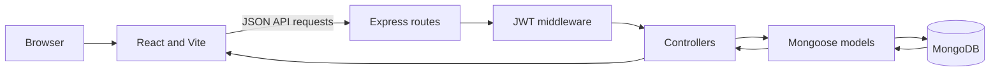
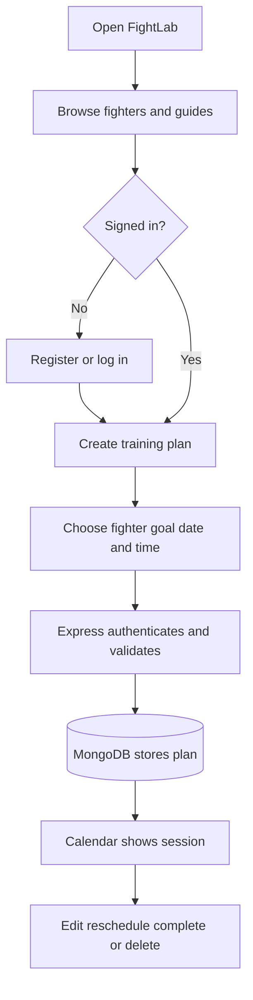
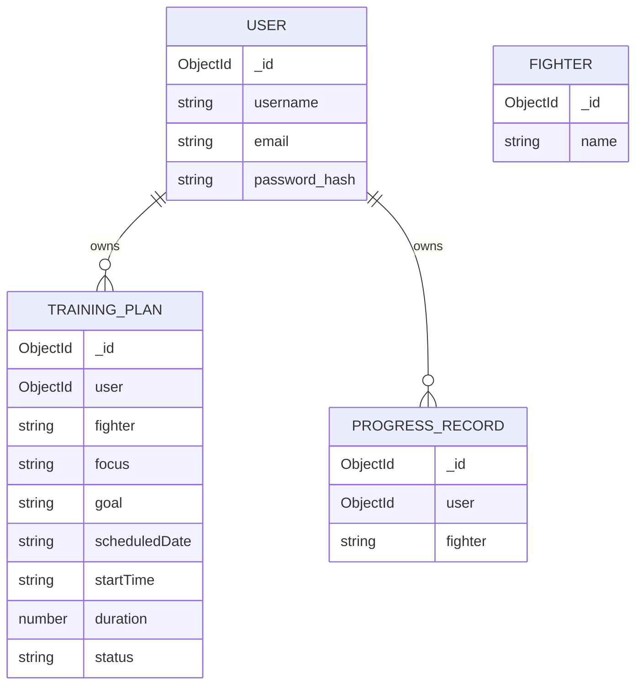

# FightLab architecture and database design

## Client/server request flow

## User journey

## Logical data relationships

TrainingPlan.fighter is a **string**, not a MongoDB ObjectId reference to Fighter. The diagram therefore does not assert a database-enforced relationship between these collections. Confirm fields in `server/models/` before presenting a detailed physical model.

## Physical persistence
MongoDB collections are represented by Mongoose schemas in `server/models/`: User, Fighter, TrainingPlan, ProgressRecord, and Content. `TrainingPlan.user` references User._id; the training plan schema also defines an index on `(user, scheduledDate, startTime)` for calendar lookups. Authentication uses JWT in the request header and bcrypt password hashes.
