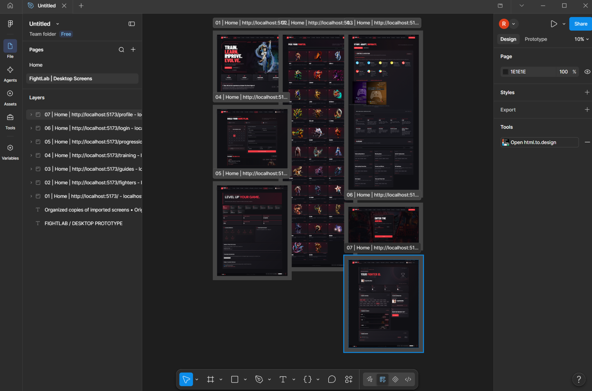
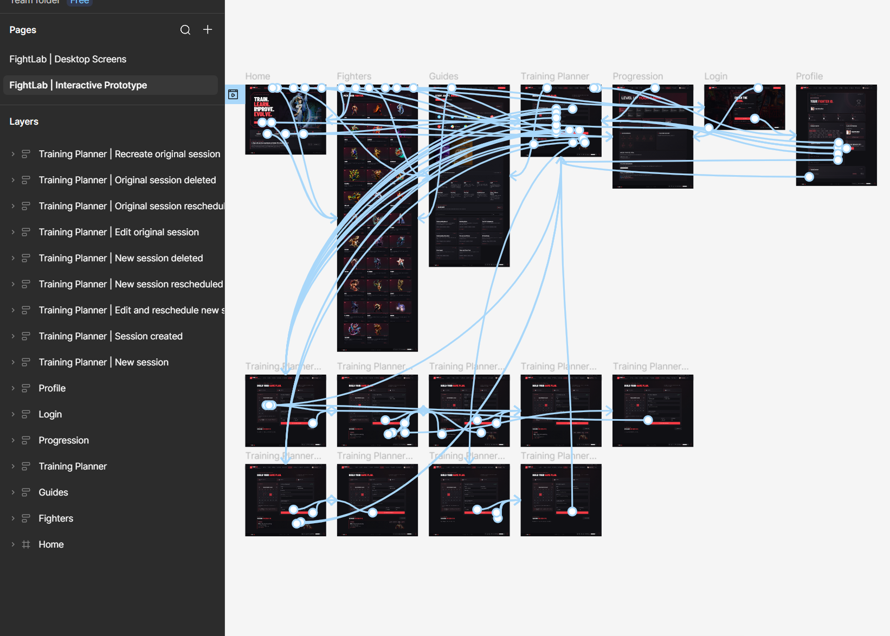

# FightLab — Figma Design and Prototype Evidence

## Figma project

[Open the FightLab Figma design](https://www.figma.com/design/ApKdHEsPQ4DtBRoaUq24B5/FightLab?node-id=7-3213)

**Access note:** Figma link access may be limited to the project team. If you cannot open the link, refer to the screenshots below or request viewer access from the project owner. The link is provided as a project reference, not a guarantee of public access.

## High-fidelity desktop designs

The design canvas contains seven principal desktop views: Home, Fighters, Guides, Training Planner, Progression, Login, and Profile. The screenshots document the consistent FightLab dark-and-red interface and the organization of the desktop layouts.

## Interactive prototype

The prototype canvas shows connections among the main views and additional Training Planner states representing session creation, editing, rescheduling, and deletion. The prototype navigation was manually tested in Figma Present mode by the project owner and reported working on November 17, 2026.

These Figma interactions illustrate interface flow only. The actual application's authentication and MongoDB-backed training-session CRUD functionality are demonstrated in the running React/Express application.

## Submission evidence

These screenshots provide static evidence of the Figma design and connected prototype even when the interactive file cannot be accessed externally. A viewer with access to the Figma project can open the linked file to test the prototype directly.
