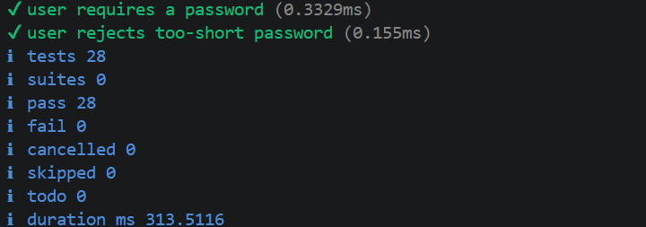

# FightLab testing report

## Automated tests
Automated tests were executed successfully on the local development machine on November 17, 2026. Additional live-database and browser acceptance tests remain to be documented.

| Test group | Coverage | Status |
|---|---|---|
| TrainingPlan schema | required fields, date/time format, duration, status | Passed in local automated suite |
| User schema | password required and length | Passed in local automated suite |
| JWT middleware | missing, empty, malformed bearer token | Passed in local automated suite |
| Auth HTTP routes | authenticated `/me`, token rejection (mocked user lookup) | Automated; registration/login still need DB-backed tests |
| Planner HTTP routes | create, list, read, reschedule, delete, ownership (mocked persistence) | Automated; DB-backed tests still needed |
| Browser UI | navigation, responsive layout, planner persistence | Manual verification required |

## Manual API acceptance checklist
Use a **separate test account and test database**.
- [ ] Register and log in; save the bearer token
- [ ] Create two sessions and verify both appear in GET /api/training-plans
- [ ] Change a session goal and verify the new value persists
- [ ] Move a session to another date and confirm calendar updates after refresh
- [ ] Mark a session complete and confirm status updates
- [ ] Delete a session and verify it no longer appears
- [ ] Attempt unauthorized access without a token; expect 401
- [ ] Attempt to access another account's plan; expect 404 or another safe rejection
- [ ] Submit invalid date/time/duration; verify validation errors

## Responsive acceptance checklist
- [ ] 390px: navigation, fighter cards, calendar, login, and planner usable
- [ ] 768px: no clipped panels or overlapping controls
- [ ] 1440px: desktop presentation consistent with Figma
- [ ] Keyboard navigation and visible focus on key controls

## Execution evidence
Date: November 17, 2026. Local command: `npm test` in `server/`.
Automated tests: **28 passed, 0 failed, 0 skipped**, duration **313.5116 ms**.
Screenshot: [Automated test results](automated-test-results.png).
Known limitation: HTTP route tests mock database persistence; live MongoDB integration testing remains outstanding. Mongoose emits `validateSync()` deprecation warnings, which do not fail tests.

## Package verification (2026-11-17)
Executed `npm test` using Node.js v22.16.0 and dependencies extracted from the uploaded ZIP: **16 passed, 0 failed**. These are schema and authentication-middleware tests only; no database-backed API or browser tests were executed. Mongoose reported a deprecation warning for `validateSync()`; tests still passed. Re-run after `npm install` on your machine.

## HTTP route test verification (2026-11-17)
The added `server/tests/api-routes.test.js` exercises Express HTTP routes with signed JWTs and in-memory model stubs. It covers 11 subtests for access control, `/api/auth/me`, and training-plan CRUD. It **does not** connect to MongoDB or test real registration/login database persistence.

Package verification: `npm test` under Node.js v22.16.0 reported **28 passing test entries, 0 failures** (16 existing tests, 11 new HTTP route subtests, and 1 parent suite entry counted by Node). Run on the local machine and record its output before submission. The user separately reported 16/16 existing tests passing and a successful Vite build.

## Local automated test screenshot (November 17, 2026)

The screenshot captures the summary of a local `npm test` run. It confirms 28 test entries passed with zero failures, zero skipped, and zero cancelled. The screenshot alone does not establish real-database integration coverage.
